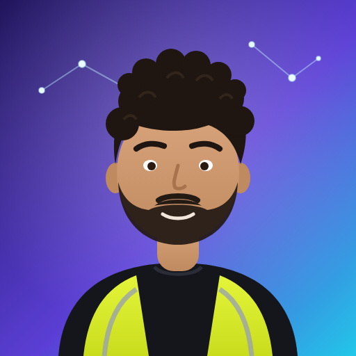
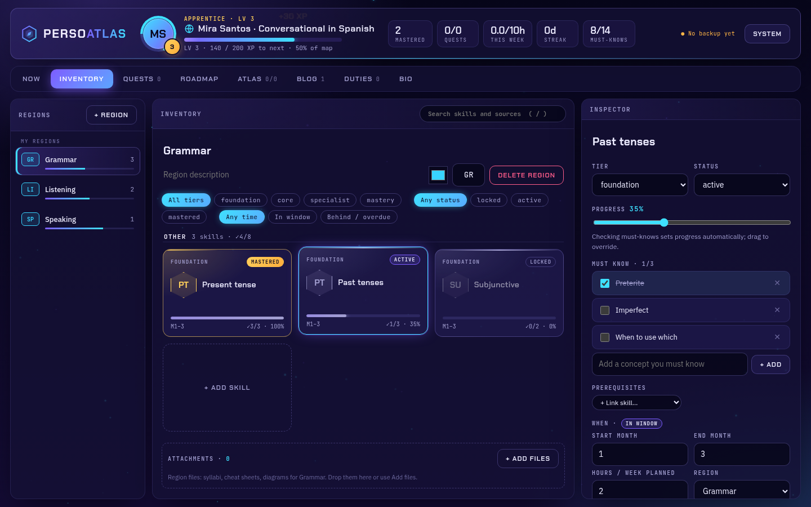
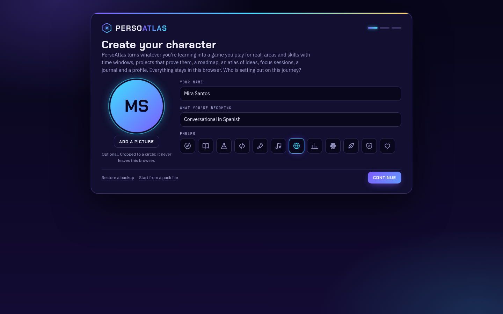
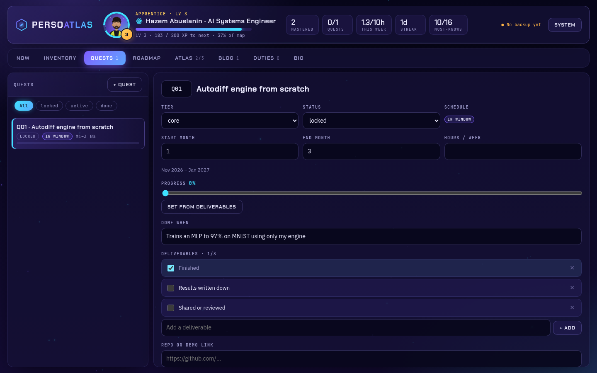
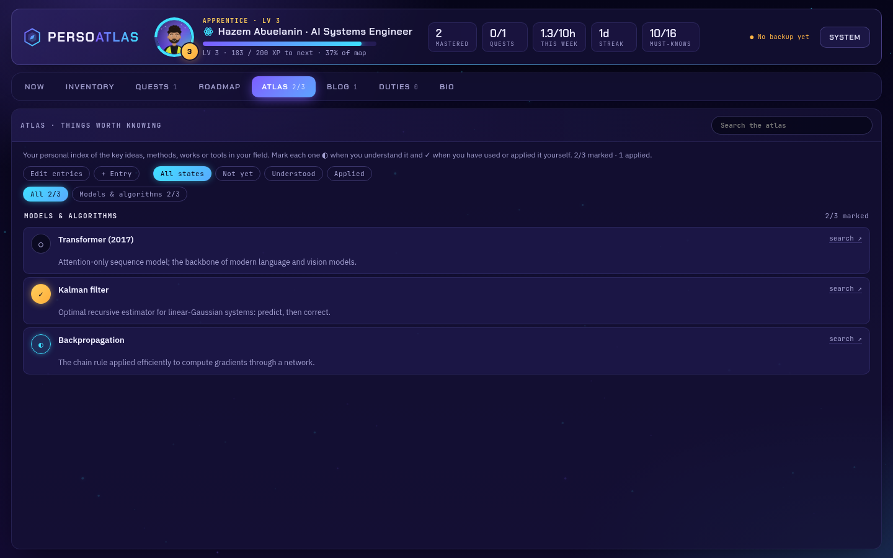
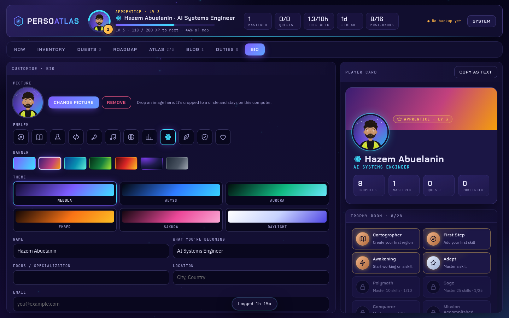
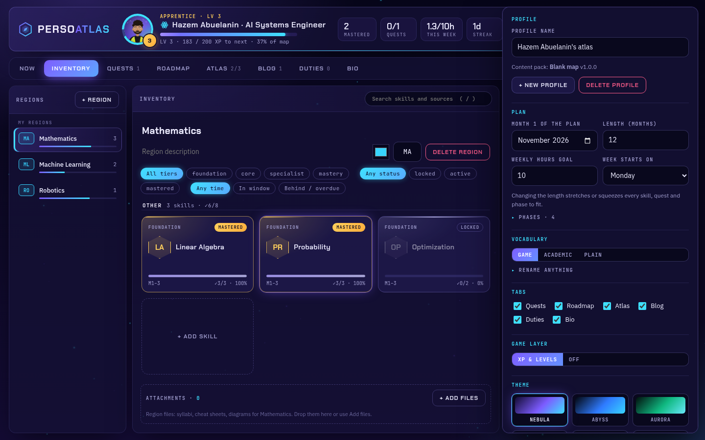
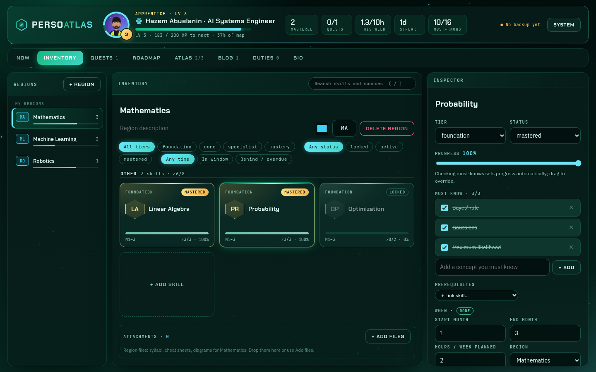
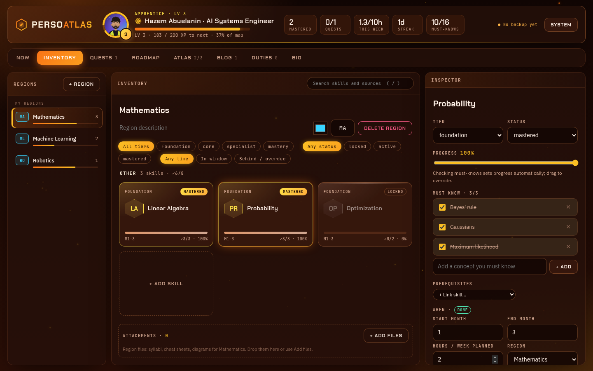
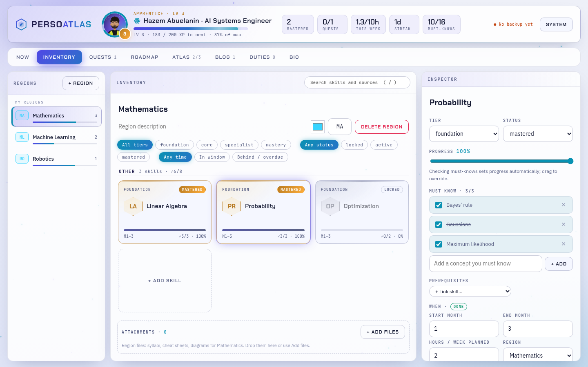

<div align="center">



# PersoAtlas

### Your own atlas for a lifetime of learning, built like a game.

Knowledge is vast, resources are endless, and there's always more to learn than time to learn it.<br>
PersoAtlas lets you **map your journey, prove your progress, and level up** while you do it.

[](LICENSE)


**[Launch it in your browser](https://hazemabuelanin.github.io/PersoAtlas/)** · [Download the single file](../../releases/latest) · [Features](#what-you-get) · [Content packs](#content-packs) · [Contributing](CONTRIBUTING.md)



</div>

---

## Why this exists

Whether you're becoming an engineer, a researcher, a doctor, a designer or a polyglot, the hard part isn't finding material. It's **keeping the whole journey in one place**: what you need to know, in what order, what you've actually mastered, what you've built to prove it, and how much time you really put in.

Roadmaps live in one app, notes in another, projects in a third, and progress nowhere. So we lose track, start over, and forget what we learned.

PersoAtlas is a single place for all of it, with three beliefs behind it:

1. **Keep your own atlas.** Nobody else's roadmap fits you exactly. You build your map, at your pace, in your words.
2. **Open and yours.** Open source, no account, no server, no tracking. Your data lives in your browser and your backups, and you can change anything about the app itself.
3. **Learning should feel like play.** Life is a game worth playing well: XP, levels, ranks, unlocks and trophies make steady progress visible and fun, and you can switch them off if you prefer it calm.

## What you get

<table>
<tr>
<td width="50%"><br><b>Create your character.</b> Picture, name, what you're becoming, an emblem and a theme. A loading screen greets you with your avatar, level and rank.</td>
<td width="50%"><br><b>Play it like a game.</b> XP on everything you do, nine ranks from <i>Novice</i> to <i>Mythic</i>, unlock cards, a level-up screen and 28 trophies. Sound is optional, and the whole layer can be switched off.</td>
</tr>
<tr>
<td><br><b>Now.</b> Where you stand against your plan, weekly goals and review, a focus timer, a session log and streaks, plus starter quests that teach the app as you use it.</td>
<td><br><b>Quests.</b> Projects that prove your skills, each with a time window, a measurable “done when” and deliverables.</td>
</tr>
<tr>
<td><br><b>Atlas.</b> Your index of the ideas, models, methods or works that matter, marked as <i>understood</i> or <i>applied</i>.</td>
<td><br><b>Profile.</b> A shareable player card with banner, emblem, motto and links, plus your trophy room.</td>
</tr>
<tr>
<td><br><b>Roadmap.</b> Every skill and quest on one timeline of any length (1 month to 20 years), with phases, planned load and conflict checks.</td>
<td><br><b>Everything is configurable.</b> Rename every tab and term, hide tabs, change the plan length, keep several profiles, and back up to a folder.</td>
</tr>
</table>

<div align="center">
  <br>
<sub>Six themes: Nebula, Abyss, Aurora, Ember, Sakura and the light Daylight theme</sub>
</div>

### Built for anyone who learns

| You are… | Your atlas holds… |
|---|---|
| A **student** | Courses as regions, topics as skills, exams and assignments as quests, a study journal |
| A **researcher** | Literature, methods and statistics; milestones (proposal, first paper, thesis); a methods atlas |
| An **engineer** | Foundations → specialisation, portfolio projects, an atlas of models, algorithms and tools |
| A **career changer** | The skills a new role needs, the projects that prove them, applications as experience |
| **Anyone** | Spanish, guitar, painting, chess: the vocabulary bends to you (*Game*, *Academic*, *Plain* or your own words) |

### At a glance

| | |
|---|---|
| **8 views** | Now · Inventory · Quests · Roadmap · Atlas · Journal · Experience · Profile |
| **Game layer** | XP, levels, 9 ranks, 28 trophies, unlock moments, level-up screen, optional sound |
| **Personal** | 6 themes, 7 banners, 12 emblems, your picture, 3 vocabularies plus custom wording, hideable tabs |
| **Your data** | Browser storage, one-file backups with attachments, folder sync, several profiles |
| **Shareable curricula** | Content packs in YAML, schema-validated, upgradable without losing progress |
| **Footprint** | One ~640 KB HTML file · works offline · no account · no server · zero network requests |
| **Quality** | Unit tests for the data model, migrations and achievements; end-to-end browser tests; CI |

## Getting started

| How | Steps |
|---|---|
| **In the browser** | Open **https://hazemabuelanin.github.io/PersoAtlas/**. Nothing to install. |
| **Offline, one file** | Download `index.html` from the [latest release](../../releases/latest) and double-click it. |
| **From source** | `git clone git@github.com:HazemAbuelanin/PersoAtlas.git && cd PersoAtlas && npm install && npm run dev` → http://localhost:5173 |

Build the single-file app yourself with `npm run build`; the result is `dist/index.html`. Requires Node 20+.

## Your data stays yours

Everything is stored in your browser (`localStorage` for your atlas, IndexedDB for attachments). The app makes **no network requests**. Because browsers can clear storage under pressure:

- **Export** a backup now and then (System → Export backup). It's one JSON file with every attachment inside.
- Or **link a backup folder** (Chrome/Edge) and every change is written to disk. Keep it in Dropbox/Drive/OneDrive to use the same atlas on several computers.

## Content packs

PersoAtlas ships **empty**, and you build your own map. You can also start from a **content pack**: a curriculum someone wrote (regions, skills, quests, atlas entries, plan, vocabulary) as a few YAML files.

- **Use one**: on the first screen choose *Start from a pack file*.
- **Write one**: copy [`docs/pack-template`](docs/pack-template), follow [docs/writing-a-pack.md](docs/writing-a-pack.md), then `node scripts/build-packs.mjs --dir ~/my-packs`.
- **Upgrade without loss**: when a pack gets a new revision, load it (System → Update from pack file). New content merges in, and your progress, notes and own additions stay.

## Under the hood

Vanilla JavaScript ES modules, no framework and no runtime dependencies. Vite inlines code, styles and fonts into one HTML file. The data model is pure and unit-tested (Vitest), and the whole app is tested end to end in Chrome (Playwright). Read [docs/architecture.md](docs/architecture.md).

```bash
npm run check      # lint · validate packs · unit tests · build · end-to-end tests
```

## Roadmap

- Translations (i18n)
- Installable app (PWA)
- A gallery of community content packs
- Optional encrypted sync between devices

## Contributing

Ideas, bug reports, themes, emblems, trophies, translations and packs are all welcome. Start with [CONTRIBUTING.md](CONTRIBUTING.md) and the [Code of Conduct](CODE_OF_CONDUCT.md).

## License and attribution

PersoAtlas is open source under the [MIT License](LICENSE). You are free to use it, modify it, fork it, redistribute it and build on it, including commercially.

The one condition: **keep the credit.** PersoAtlas was created by **Hazem Abuelanin**. If you use, copy or modify it, keep the copyright notice in [LICENSE](LICENSE) and [NOTICE](NOTICE), and mention the original author where you present your version (README, about page or credits), for example:

> Based on [PersoAtlas](https://github.com/HazemAbuelanin/PersoAtlas) by Hazem Abuelanin.

Content packs carry their own license in their `pack.yaml`.

<div align="center"><sub>Made by <a href="https://github.com/HazemAbuelanin">Hazem Abuelanin</a>, for everyone who keeps learning.</sub></div>
