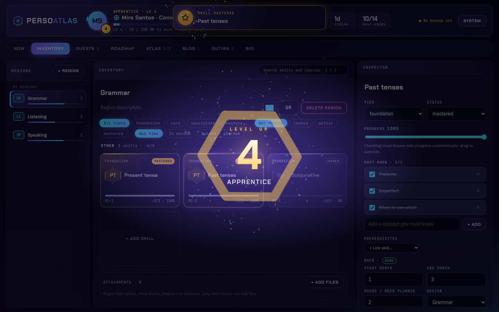
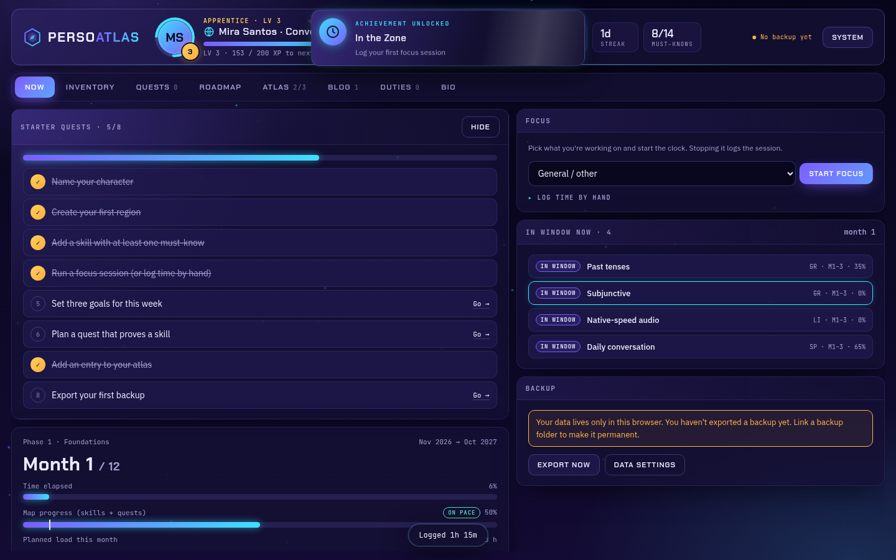
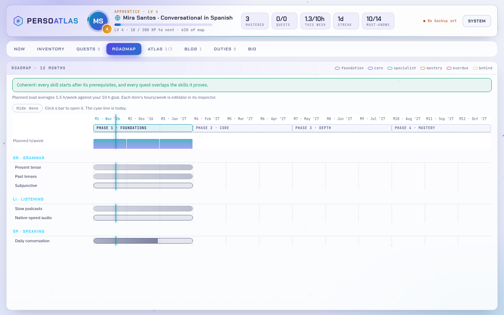

<div align="center">

# PersoAtlas

**Turn whatever you're learning into a game you play for real.**

A local-first, game-like atlas for any learning journey: a degree, a research project, a new career, a language, an instrument. Map the skills, plan the projects that prove them, track focus time, collect the ideas worth knowing, and level up as you go.

No account. No server. Your data never leaves your browser. One HTML file.

[Try it](#getting-started) · [Features](#features) · [Content packs](#content-packs) · [Contributing](CONTRIBUTING.md)


</div>

---

## Why

Knowledge is vast and resources are endless. Most learners keep a roadmap in one app, notes in another, projects in a third, and progress nowhere at all. PersoAtlas puts the whole journey on one map, a map you build yourself, and makes moving across it feel like progress in a game: XP, levels, ranks, unlocks and a trophy room.

It works for anyone:

| You are… | Your map might hold… |
|---|---|
| A **student** | Courses as regions, topics as skills, exams and assignments as quests, a study journal |
| A **researcher** | Literature, methods and statistics as regions; milestones (proposal, first paper, thesis) as quests; a methods atlas |
| An **engineer** | Foundations → specialisation, portfolio projects as quests, an atlas of algorithms and tools |
| A **career changer** | The skills a new role needs, the projects that prove them, applications as experience |
| **Anyone learning anything** | Spanish, guitar, painting, cooking: the vocabulary adapts to you |

## Features

<table>
<tr><td width="50%"></td><td width="50%"></td></tr>
<tr><td><b>Create your character.</b> A picture, a name, what you're becoming, an emblem, a theme. A loading screen greets you with your avatar and rank every time.</td><td><b>Feels like a game.</b> XP and levels, rank titles, unlock cards, a level-up screen, a trophy room with 28 achievements, optional sound effects. Or switch the game layer off entirely.</td></tr>
<tr><td></td><td></td></tr>
<tr><td><b>Now.</b> Where you stand against your plan, weekly goals and review, a focus timer, a session log, what's due this month, and starter quests that teach you the app.</td><td><b>Profile.</b> A shareable player card with banner, emblem, motto and links, plus your trophy room.</td></tr>
</table>

- **Inventory**: regions (areas) of skills, each with a tier, a time window, hours per week, must-knows that drive progress, prerequisites, sources and attachments.
- **Quests**: projects with a "done when" bar and deliverables, linked to the skills they prove.
- **Roadmap**: a timeline of every skill and quest across your plan (any length, from 1 month to 20 years), with phases, a planned-load chart and conflict detection.
- **Atlas**: your index of the ideas, methods, works or tools worth knowing, each marked at three levels.
- **Journal** (Blog), **Experience** (Duties) and **Profile**: write up what you learned, log real-world work as CV-ready entries, and present yourself.
- **Your words**: rename every tab and term (Inventory → Subjects, Quests → Projects…), or pick the *Game*, *Academic* or *Plain* vocabulary. Hide tabs you don't need.
- **Six themes**: Nebula, Abyss, Aurora, Ember, Sakura and the light Daylight theme, plus banners and emblems.
- **Several profiles** in one browser, each fully separate.
- **Attachments**: drop PDFs, images, notes and code onto anything, with in-app previews.
- **Your data, your disk**: backups include every attachment; link a folder (Chrome/Edge) to sync every change to disk or a cloud-synced drive.
- **Accessible and calm**: keyboard-friendly, respects *reduced motion*, effects and sound can be turned off.



## Getting started

**Use it.** Download `index.html` from the [latest release](../../releases/latest) and open it in any modern browser, or open the hosted copy on GitHub Pages. That's it: it's one self-contained file that works offline.

**Run it from source.**

```bash
git clone <this repository>
cd persoatlas
npm install
npm run dev        # http://localhost:5173
npm run build      # → dist/index.html, the single-file app
```

Requires Node 20+.

## Your data

Everything lives in your browser's storage (`localStorage` for your atlas, IndexedDB for attachments). Nothing is sent anywhere; the app makes no network requests at all. Browsers can clear storage under disk pressure, so:

- **Export** a backup now and then (System → Export backup). It's one JSON file with every attachment inside.
- Or **link a backup folder** (Chrome/Edge): every change is written to disk. Put the folder in Dropbox/Drive/OneDrive to use the same atlas on several computers.

Restore a backup from the first screen (*Restore a backup*) or from System → Import backup.

## Content packs

PersoAtlas ships **empty**. You build your own map, or start from a **content pack**: a curriculum someone wrote (regions, skills, quests, atlas entries, plan, vocabulary) as a few YAML files.

- **Use a pack**: on the first screen choose *Start from a pack file* and pick a `.json` pack.
- **Write a pack**: see [docs/writing-a-pack.md](docs/writing-a-pack.md). Keep it anywhere, build it with
  `node scripts/build-packs.mjs --dir ~/my-packs`, and import the resulting JSON.
- **Upgrades keep progress**: when a pack author publishes a new revision, load it (System → Update from pack file) and the new content merges in. Your progress, notes and your own additions are kept.

## Tech

Vanilla JavaScript ES modules, no framework, no runtime dependencies. Vite bundles everything (code, styles, fonts and the built-in Blank map) into one HTML file. Data logic is pure and unit-tested with Vitest; the whole app is tested end to end in Chrome with Playwright. See [docs/architecture.md](docs/architecture.md).

```bash
npm run check      # lint, validate packs, unit tests, build, end-to-end tests
```

## Contributing

Bug reports, ideas, translations, themes and packs are all welcome. Read [CONTRIBUTING.md](CONTRIBUTING.md) to get started, and please follow the [Code of Conduct](CODE_OF_CONDUCT.md).

## License

Code: [MIT](LICENSE). Content packs carry their own license in their `pack.yaml`.
